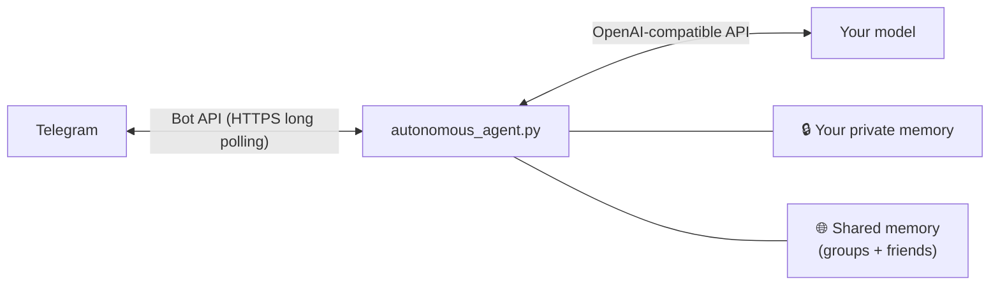

# AI2TG · Telegram AI Companion

<div align="center">

[](https://opensource.org/licenses/MIT)
[](https://www.python.org/downloads/)
[](https://core.telegram.org/bots/api)
[]()

**A self-hosted AI companion that lives in your Telegram, remembers you, and stays yours —<br>even when it chats in groups and with your friends.**

</div>

---

## ✨ What makes it different

Most chatbots answer every message and forget everything. AI2TG is built to feel like **one continuous person** who knows exactly who its owner is.

| | |
|---|---|
| 🔐 **It knows who you are, by user ID** | Your identity is checked against your numeric Telegram user ID in code. Display names, usernames, fake `【Master✔】` labels or "I'm your master" from someone else change nothing. |
| 🧠 **Memory that never quietly disappears** | New facts are only *added*, with dates. Tidying happens only when memory gets large, with automatic backups in `backups/`. Corrections (Wed → Thu, likes → doesn't like) are kept, not dropped. |
| 🗂️ **Your private memory stays private** | What you tell it in private chat is never loaded into groups or other people's chats. Those share one public memory (or one each, if you prefer), so it still recognises people across a group and their private chat. |
| 👥 **Group chat that doesn't spam** | Speaks only when its name is mentioned, it's @mentioned, or someone replies to it. Per-member message limits. It can skim the group now and then and **tell you privately** if something interesting happens. |
| 💬 **Chats with your friends, safely** | Other people can talk to it too (whitelist / blacklist), each with a message limit, under the same rules as a group. |
| 👀 **Sees what you see** | Photos, stickers (even animated ones), GIFs, voice messages, documents, forwards and **replies**. If the model can't see or hear, you get a clear warning instead of a made-up answer. |
| ⌨️ **Types like a person** | Plain text, several short bubbles in a row with "typing…", real voice messages (Edge-TTS), emoji faces, stickers it collects and sends back as real Telegram stickers, and it may choose not to answer at all. |
| 🪶 **Light and simple** | One Python process, ~30 MB RAM, outgoing HTTPS only (long polling): no webhook, no open ports, no Docker. Optional proxy if Telegram is blocked where it runs. |

> Group chat and friend chat are **off by default**. Turn on only what you want in `config.json`.

---

## 🚀 Quick start

1. Create a bot: open **@BotFather** in Telegram → `/newbot` → copy the token.
2. Install and run:

**Linux / macOS**
```bash
git clone https://github.com/intfloatjohn/AI2TG.git
cd AI2TG
./setup.sh     # first time: Python env, ffmpeg, TTS voice, config.json (asks for the token and API key)
./start.sh     # every day
```

**Windows:** double-click **`setup_windows.bat`** once, then **`start.bat`** every day.

3. Open your bot in Telegram and press **Start**. The log prints your user ID; put it in `config.json` as `master_id`:
```json
{
  "telegram_bot_token": "123456789:AAH...",
  "api_key": "YOUR_API_KEY",
  "base_url": "https://openrouter.ai/api/v1/chat/completions",
  "model": "google/gemini-3.8-flash",
  "master_id": 123456789
}
```
Works with any OpenAI-compatible API: OpenRouter, Gemini, DeepSeek, GPT, Claude via proxies, and more.

<details>
<summary><b>Turn on the extras</b></summary>

```json
{
  "enable_group_chat": true,
  "group_whitelist": [-1001234567890],
  "group_member_msg_limit": 50,

  "enable_friend_chat": true,
  "friend_whitelist": [234567890],
  "private_member_msg_limit": 50,

  "memory_mode": "shared",

  "telegram_proxy": "",
  "thinking_level": "",
  "thinking_level_background": "low"
}
```
For groups, disable the bot's privacy mode in @BotFather (`/setprivacy`). Every option is explained in the [user guide](USAGE.md#12-configuration-reference-configjson).
</details>

---

## 🧩 How it works



Every chat has its own short-term history and log under `sessions/`. Who may do what (edit the picture library, read your memory, message you) is decided **in code** from real Telegram user IDs, never by asking the model.

---

## 📚 Features in detail

<details>
<summary><b>Memory</b></summary>

- Short-term context (`history.json`) plus long-term memory (`memory_summary.txt`) the model can read and update anytime with `[remember: …]`.
- AutoCompact pulls new facts out of older messages and appends them; nothing is rewritten. Answers cut off by "thinking" models are retried automatically.
- Full chat log (`chat_history.jsonl`) searchable with `[search_history: …]`.
- `memory_mode`: `shared` (groups and friend chats share one public memory, with sources) or `separate` (one per chat). Per-chat files are always kept.

See [USAGE §3](USAGE.md#3-autocompact-long-term-memory--realtime-memory-updates).
</details>

<details>
<summary><b>Group chat</b></summary>

- Triggered by name keywords, @mention, or replies to the bot; follow-up messages from the same person (like a photo album) are merged.
- Each member is labelled by code with their real user ID; injected labels are stripped.
- Photos, stickers, voice and files are opened when needed and remembered for 7 days with short descriptions.
- Replies as a threaded Telegram reply, in the right forum topic.
- Skims the group every ~10 minutes and may privately tell you something (max 3 per hour).

See [USAGE §15](USAGE.md#15-group-chat).
</details>

<details>
<summary><b>Friend chat</b></summary>

Other Telegram users (whitelist recommended, since anyone can find a bot); identity by user ID; per-person limit; limited tools; you can ask "what did you talk about with Fred?". See [USAGE §16](USAGE.md#16-friend-chat).
</details>

<details>
<summary><b>Senses and expression</b></summary>

- Vision and native audio for multimodal models; speech-to-text fallback (any Whisper-compatible API); document text extraction; forwards; replies and quotes; polls, locations, dice and more as text.
- Clear `NOT A VISION MODEL` / `VISION IS NOT AVAILABLE: API ERROR` warnings, with an automatic retry without the media.
- Multi-bubble typing (`[SEP]` or blank lines) with "typing…", Edge-TTS voice messages, emoji faces, a sticker library the bot curates itself (Telegram stickers and GIFs are resent as the real thing).
- Live web search and weather.

See [USAGE §5–§9](USAGE.md).
</details>

<details>
<summary><b>Model control</b></summary>

- `thinking_level` / `thinking_level_background`: `none`–`high`, sent the right way for OpenRouter, DeepSeek or OpenAI-style APIs; refused levels fall back automatically.
- Tool-call and web-search limits per reply to keep costs predictable; `usage_report.py` shows where the tokens go.
- Hot-reloaded persona files in `persona/`.
</details>

<details>
<summary><b>Integrations</b></summary>

`mcp-server/telegram_mcp.py` exposes the companion to MCP clients such as Claude Desktop or Cursor. See [USAGE §11](USAGE.md#11-mcp-server-mcp-servertelegram_mcppy).
</details>

---

<details>
<summary><b>🐧 Headless server deployment (systemd)</b></summary>

```bash
./deploy_debian.sh
sudo cp tg-companion.service /etc/systemd/system/
sudo systemctl daemon-reload
sudo systemctl enable --now tg-companion
```
See [USAGE §13](USAGE.md#13-linux-server-deployment-systemd).
</details>

## 📖 Documentation

- **[User guide](USAGE.md)**: every feature and setting.
- [Persona & tool tags](persona/tools.md) · [Stickers guide](stickers/STICKERS_GUIDE.md)
- Telegram edition of [AI2QQ](https://github.com/intfloatjohn/AI2QQ); see [what changed](USAGE.md#17-coming-from-ai2qq).

## ⚖️ License

[MIT](LICENSE). Keep your bot token secret, keep the default message limits, and prefer a friend whitelist.
